# Native architecture

Logchat is a local hybrid RAG context service. Adapters extend how it receives events; they do not replace the shared memory system.

```mermaid
flowchart LR
  F[File / wrapped app / Docker / Railway / Vercel / CLI / push] --> N[Normalize events]
  N --> G[Shared local model: group]
  G --> C[Shared local model: compact summary and selected fields]
  C --> Q[Durable compact jobs]
  Q --> E[Embedding capability]
  E --> S[SQLite readable chunks + sqlite-vec + FTS]
  A[Agent query and scope] --> R[Scoped vector and lexical retrieval]
  S --> R
  R --> M[Shared local model: relevance selection]
  M --> O[Context, supporting memories, provenance and gaps]
  O --> A
```

Generation uses one model profile across grouping, summary and relevance roles. Embeddings are a separate capability with a digest/dimension-bound index. Original message bodies are transient in summary-only intake. Explicit temporary capture uses a bounded protected spool outside retrieval, then clears originals after durable compact acceptance or expiry.

Provider observation cursors and file positions identify what an adapter has accepted. The scheduler tracks durable jobs and indexing separately. A captured window does not establish complete coverage; a successful source connection does not establish that retrieval is ready. Invalid output and failed model calls retain gaps and do not publish candidates as selected evidence.

Temporary-original capture claims rotate over ready owner/project/environment/source scopes using a durable cursor. Each scope has at most one active claim; delayed retries and active leases let other scopes proceed. The 400-event claim and byte limits still apply. This bounds turns among ready captured sources across restart.

Summary-only intake reserves FIFO retry turns across synchronous and asynchronous adapters, keyed by local state directory and full owner/project/environment/source scope. A hot source cannot reacquire ahead of another live reserved source. At most 256 waiting identities are retained, without event bodies; overflow returns the existing busy retry response. Reservations expire after 10 seconds without a retry, allowing disconnected producers to stop blocking progress. Producers must retry within that interval to retain their turn. Model-settings changes and capture draining share the same exclusion and respect reserved retries. Reservations are process-local and reset on restart; captured-source rotation remains durable. These admission guarantees do not reduce model processing time or guarantee a wall-clock completion bound for model work.

Readable memory contains model-written compact text, selected original values, scope, timestamps, exact measurements and loss notes. Code validates selected values and membership; prose itself is an unverified model interpretation. Native vector search uses exact eligible-vector cosine similarity, with lexical candidates combined by reciprocal rank fusion. Ranking is not calibrated confidence.

Within one bounded transient intake batch, exact repeated ordered validated message views form cohorts inside the same owner/project/environment/source, service, severity, release and time-bucket cell. The grouping model evaluates one representative of each cohort; validated membership expands against every current original record before section packing. IDs, timestamps, measurements and attribution are never copied from representatives. Cohort equality and partition, coherence review and repair requests use the same view. Identical grouping requests also reuse a validated partition and coherence review, including schema, local references, proposal and repair state. All cohort records and request caches are transient and discarded at the end of the call.

Expanded sections retain the unchanged 16K character bound and exact coverage validation. Before compact generation, deterministic packing splits each model-selected section further when its canonical mandatory correlation catalog exceeds 64 entries, its request exceeds the configured character/byte budgets, or mandatory durable evidence exceeds 16K characters/64K bytes. All sections are preflighted before any compact call; an oversized single fails closed. Packing never joins model-selected topics or removes original ID aliases, types or refs. Optional model selections and actual uncertainties still pass the independent post-generation evidence guard and can reject the batch. Compact summaries are still generated separately for every resulting section with current metrics and metadata; no summary prose is reused. Packing repeated records across former grouping-page boundaries reduces compact calls, but original-record size and compact field/output budgets remain limits. A cohort containing one distinct message needs no multi-topic coherence review; mixed-message proposals retain review and repair. This optimization does not establish real-model 400-event or 100K completion.

Compact model records contain local refs and validated transient message views, falling back to complete canonical messages when trusted origin is absent. Shared service, severity and release appear once in the request context, alongside current exact aggregate metrics, observed first/last timestamps and span, and the bounded original field catalog. Replay keys, source IDs and per-event metadata are assembled independently from validated originals into durable evidence; they are not repeated in model rows. Identifiers and numbers inside producer text remain unchanged. Selected field refs expand against the current original catalogs and exact event memberships, including correlation fields retained independently of model selections. Input/output and per-call budgets and canonical digest computation are unchanged. Request feasibility uses the same validated views as generation; canonical mandatory catalogs and durable evidence still determine independent packing limits.

Native compact intake now emits `native_intake` JSON diagnostics through the `logchat.local.rag_runtime` Python logger. Enable INFO logging and a handler for that logger when running model QA to capture completed-stage durations, section counts and individual grouping/compact model-call durations; failures and cancellations also emit WARNING records. A final record reports the active stage, its elapsed time, total intake time and started call counts by role, including an unfinished call when the unchanged 300-second deadline expires. Call success means the provider returned, not that its output passed semantic validation. Grouping counts include partition, coherence review and repair calls. A random attempt ID links records without logging source identities, timestamps, event bodies, model payloads, selected fields or provider exception text. Timing state is constant-size and transient; diagnostics do not change requests, model selection, persistence or retry responses.

Preserving push normalization retains the canonical parser/source representation, including supplied `event_id` and `id` structured fields. Canonical messages and inferred fingerprints bind replay digests; model throughput changes must use bounded transient projections after replay validation, without altering canonical evidence or accepting source-supplied digest overrides. Conflicting aliases, arbitrary raw identifier types, overlong originals, correlation fields and identifiers/numbers in producer text retain their existing semantics. The complete supplied input still counts against admission budgets. Summary-only persistence retains compact selected evidence and exact metadata rather than an additional original-message copy. Same-body replay checks the existing durable digest before generation in both summary-only and temporary-capture modes. See [canonical replay QA](qa/canonical-replay-and-throughput.md) for compatibility evidence and unresolved throughput work.

The preserving parser additionally creates internal versioned normalization provenance containing only the appended suffix boundary and a hash of current canonical content and attribution. This descriptor is excluded from replay equality/digests and the wrapped-process HTTP wire representation. Producer-supplied provenance claims remain ordinary structured source fields. Valid provenance can derive a transient message view that preserves the entire producer prefix and omits only appended top-level string `event_id`/`id` values exactly matching the current full event ID. Other aliases, numeric types, nested IDs and truncated originals remain present. Changed attribution, redaction, malformed descriptors and legacy inputs fall back to the full canonical message. Valid descriptors round-trip only in the temporary raw spool and are removed with its payload. After replay checks, runtime passes a call-local event sidecar into grouping and compact generation. Every typed canonical record field must match the sidecar before using its validated view; arbitrary replacement strings and stale events cannot override model input. The sidecar and views never enter durable records. Compact field catalogs still use canonical messages, preserving every mandatory original ID alias and current event ref. Compact prose and uncertainties reject full canonical-message echoes, full projected-message echoes and full original producer-body echoes using exact equality or containment for bodies of at least 80 characters. These privacy checks use validated origin boundaries and retain no additional raw body in durable state. Legacy pending records cannot acquire trusted origin from suffix syntax and retain the conservative model-input path.

Diagnostic construction now occurs inside the slot-release guard, with silent timing fallback on ordinary initialization errors. Diagnostic serialization and logging are best effort; raising handlers cannot replace successful receipts, provider error classification or cancellation. Fault-injection tests exercise enabled INFO/WARNING handlers at every emission kind, constructor/UUID failures and subsequent slot reacquisition.

Output is retrieved context, not generated solutions. The read-only project-bound MCP lets the requesting agent inspect supporting memories. Source and settings changes are local authenticated control operations. Provider credentials live separately from event memory, and token values are never in source status.

Long-term consolidation, year-scale retention quality, hosted model setup, external legacy-history migration and broad live-provider acceptance remain separate work. The older Docker/pgvector stack is retained but does not back this native pipeline.

## Repository boundaries

`src/logchat/rag` is the active semantic core, `src/logchat/local` owns service/setup/capture, and `src/cli/native.py` is the public CLI. Shared transports and contracts live under `src/connectors` and `src/pipeline`. Compatibility API/CLI modules remain for shared client contracts and regression coverage. Earlier deployment assets are preserved on the `archive/legacy-stack` branch.

A fresh installation must select a generation model, embedding model and dimension. No named model is bundled, downloaded or selected by default. Existing index identity is retained when changing generation models.
